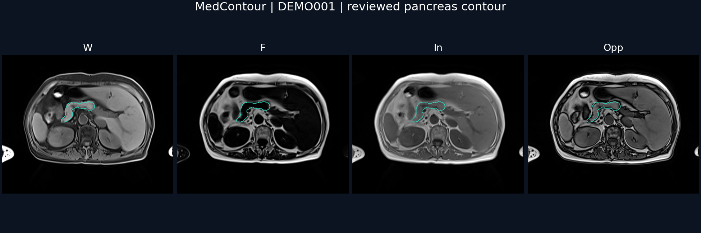

# MedContour 医学影像标注平台

面向研究团队的 Dixon 四序列影像标注与审核工作台。支持胰腺分割、PDFF ROI 标注、医生任务分配和版本追溯。前端采用 Next.js / React / NiiVue，后端采用 FastAPI / PostgreSQL，通过 Docker Compose 本机部署。



图中为仓库附带的脱敏示例病例，绿色轮廓来自已审核的人工分割掩膜。四序列 NIfTI 和掩膜均可在 [examples/demo](examples/demo/README.md) 下载；没有附带原始患者映射或其他病例。

## 功能

- Water / Fat / In-phase / Opposed-phase 原始 NIfTI 查看与三平面定位；闭合轮廓、擦除、撤销、调窗、缩放和逐层浏览。
- 标注草稿保存、提交、独立医生审核、退回返工、审核微调、通过版本锁定与撤回；历史版本不覆盖。
- 初标医生、审核医生和管理员权限；批量分配、病例分页、身份冲突隔离、操作审计。
- PDFF 三层胰头/胰体/胰尾 ROI 测量与审核；已有胰腺掩膜可作为只读参考边界。
- 协作任务、附件与版本化交付；医生 Checklist 反馈工作流。
- 可选 Codex 任务发布与开发辅助服务。核心影像标注无需配置 Codex。

本仓库提供人工标注平台及参考掩膜读取能力，不附带自动分割模型权重或模型训练管线。PDFF 结果遵循代码中的 Dixon 信号比算法，不能等同于经过独立校准验证的临床定量产品。

## 快速开始

需要 Docker Desktop（Linux 容器）或 Docker Engine + Compose，以及 Python 3.10+。默认只监听本机 `127.0.0.1:18080`。

```bash
git clone https://github.com/ljc2293/MedContour.git
cd MedContour
python scripts/init_env.py
docker compose up -d --build
```

1. 在本机打开 `.env`，读取 `INITIAL_ADMIN_EMAIL` 和随机生成的 `INITIAL_ADMIN_PASSWORD`。不要把 `.env` 提交或分享。
2. 打开 <http://127.0.0.1:18080>，登录并设置新密码。
3. 示例病例自动导入「Dixon 四序列器官分割」和「Dixon PDFF 三点 ROI 勾画」两个项目。
4. 如需直接查看随附掩膜，运行下面的示例标注导入命令，然后打开分割项目中的 DEMO001。

```bash
docker compose exec -T api python -m app.seed_demo_annotation
```

此命令只接受 `DEMO001` 示例病例和已附带的示例掩膜，只在病例尚无标注时导入为 **v1 草稿**；不会伪造新部署中的医生审核记录。重复运行不会覆盖已有标注。

管理员可以查看全部病例。实际体验保存、提交与独立审核时，在「人员管理」创建两个不同账号，分别授予初标/审核权限，并在病例列表分配给这两人。

## 日常操作

```bash
python scripts/status.py
docker compose logs --tail 100 api web gateway
python scripts/backup.py
docker compose stop
docker compose start
```

数据库、标注、预览和任务文件保存在本项目的 Docker 命名卷中，停止容器不会删除数据。备份脚本会短暂停止 API 写入，将数据库、标注和任务文件复制到本地 `backups/`，然后恢复原先运行的 API。原始影像与清单需另行备份。不要用 `docker compose down -v` 清理有正式数据的部署。

## 自有数据与部署

- 修改 `.env` 中的 `DATA_ROOT`、`MANIFESTS_ROOT` 和 `PANCREAS_PREDICTION_ROOT` 即可指向自己的数据目录；Windows 可使用 `D:/...` 格式。
- 文件布局、导入清单字段和参考掩膜说明见 [数据格式](docs/DATA_FORMAT.md)。
- 默认 HTTP 配置使用 `COOKIE_SECURE=false`，仅限回环地址。更换端口时同步修改 `APP_PORT` 和 `TRUSTED_ORIGINS`。
- 对外部署时配置 HTTPS、访问控制和备份，并设置 `COOKIE_SECURE=true` 与准确的 `TRUSTED_ORIGINS`。
- 可选任务服务的配置见 [Codex 集成](docs/CODEX_INTEGRATION.md)。

## 开发与测试

Node.js 22.13+，Python 3.10+；Docker 后端使用 Python 3.12。

```bash
npm ci
npm test
npm run build
python -m venv .venv
# Windows: .venv\Scripts\activate
# macOS/Linux: source .venv/bin/activate
python -m pip install -r backend/requirements-dev.txt
python -m unittest discover -s backend/tests -v
```

运行后端测试前设置 `PYTHONPATH=backend`（PowerShell：`$env:PYTHONPATH="backend"`；bash：`export PYTHONPATH=backend`）。测试使用临时 SQLite 数据库与临时文件，不读取正式数据库。示例影像完整性与真实导入流程也包含在测试中。

目录结构：

```text
app/                 Next.js 界面、影像工作台和 API 客户端
backend/app/         FastAPI、权限、数据模型、导入与审核流程
backend/tests/       后端自动测试
codex-worker/        可选任务服务源码
examples/demo/       单例脱敏四序列影像、掩膜、清单和预览
scripts/             本地配置生成、状态和备份工具
tests/               前端加载与 ROI 逻辑测试
docs/                数据格式、部署补充和验证记录
```

这是科研标注软件，不用于临床诊断。当前发布范围与验证结果见 [验证记录](docs/VALIDATION.md)。
