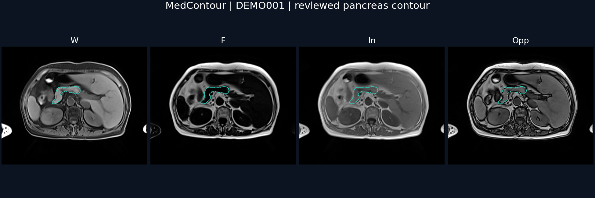

# DEMO001 示例病例

本例包含真实腹部 Dixon 四序列 MRI 和一份审核通过的人工胰腺分割掩膜，用于演示平台读取、显示、标注及参考边界。公开副本已使用统一演示标识；不提供原始身份映射、检查日期、医生姓名或源 DICOM。

| 文件 | 内容 |
| --- | --- |
| `data/DEMO001/W.nii.gz` | Water |
| `data/DEMO001/F.nii.gz` | Fat |
| `data/DEMO001/In.nii.gz` | In-phase |
| `data/DEMO001/Opp.nii.gz` | Opposed-phase |
| `data/DEMO001/pancreas_mask.nii.gz` | 二值人工掩膜：0 背景、1 胰腺 |
| `references/DEMO001/` | 同一人工掩膜的参考副本，供 PDFF 参考边界读取 |
| `manifests/` | 仅含 DEMO001 的导入清单 |
| `validation.json` | 尺寸、体素间距、完整性校验及处理记录 |

尺寸为 **320 × 260 × 42**。四序列和掩膜的空间几何一致，没有重采样或强度变换。NIfTI 采用全新头信息，原始扩展、文本字段和 sidecar 均未复制；新的 sidecar 只含演示编号、序列名和脱敏标记。

`inference_metadata.json` 是平台参考边界接口的文件名约定；本例的 `model_method_id` 明确标记为人工掩膜，**不是模型推理结果**。在新部署中运行示例导入脚本后，该掩膜作为草稿出现，不继承源平台的审核状态。

此单例用于软件演示，不用于证明分割模型性能或临床有效性。
